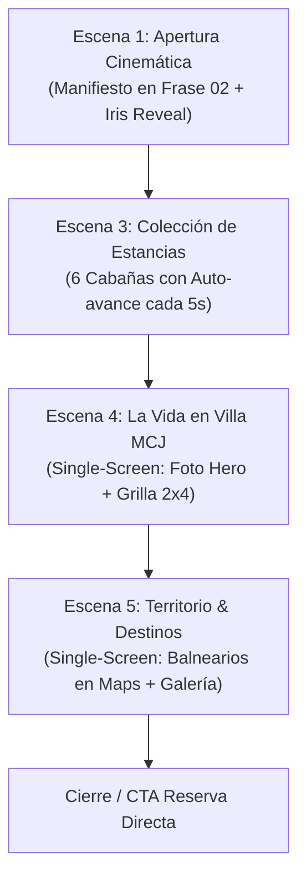

# 🏛️ Documentación Técnica & Sistema de Diseño: Villa MCJ Frontend

> **Versión**: 2.0.0 (Awwwards-Tier Editorial Architecture Review)  
> **Stack**: Astro 7.3 + React 19 + Tailwind CSS v4 + Framer Motion 13 + Lenis Smooth Scroll  
> **Backend**: Fastify 5 + Prisma ORM (API RESTful)  
> **Ubicación del Proyecto**: `Guamal/Front`  
> **Fecha**: Noviembre 2026  

---

## 1. 📐 Filosofía de Diseño & Dirección de Arte

El rediseño del frontend de **Villa MCJ** abandona las plantillas hoteleras genéricas (bloques con bordes redondeados estándar, exceso de tarjetas y badges dorados) y adopta una **dirección de arte editorial de revista de arquitectura contemporánea** (*Architectural Digest*, *Cereal*, estudios Locomotive y Active Theory):

1. **Fotografía a sangre (Full-Bleed)**: El 90% de la interfaz está gobernado por fotografía de paisaje, flora autóctona y arquitectura bioclimática.
2. **Tipografía como elemento gráfico**:
   - Titulares de escala monumental en Display Serif con soporte de contraste tipográfico (`Newsreader` / `Playfair Display`) con mezcla de romana y cursiva fluida en una misma frase (*Días de sol... Noches de brisa fresca*).
   - Datos técnicos, coordenadas y métricas en grotesca fina geométrica (`Geist`).
3. **Paleta Natural Orgánica**:
   - `Lino Matutino` (`#F4F0E8`): Fondo sereno de descanso.
   - `Piedra de Río` (`#485955`): Acentos de soporte y textura.
   - `Verde Selva Profundo` (`#12201C`): Nocturnidad, sofisticación y contraste AA.
   - `Negro Obsidiana Cálido` (`#070A09`): Sombras cinematográficas y viñetas.
   - `Terracota de Arcilla` (`#C25E3E`): Micro-acento puntual para énfasis editorial.
   - **Cero dorados artificiales** ni gradientes chillones.

---

## 2. ⚡ Arquitectura de Escenas (Single-Page Narrative Flow)

La página principal (`src/pages/index.astro`) está estructurada como un recorrido armónico de pantalla en pantalla (`100vh` en desktop), eliminando secuestros de scroll agotadores y respetando la autonomía del usuario:



### Detalle por Escena:

### **Escena 1: Apertura Cinemática (`Scene1Apertura.tsx`)**
* **Comienzo Sereno**: Arranca con el manifiesto poético central: *"El río murmura entre piedras. La selva cobija el descanso sin afán."*
* **Apertura en Iris**: Al hacer scroll, la fotografía full-bleed nace en el centro exacto y se expande orgánicamente hacia los bordes de la pantalla (`clip-path: circle(0% -> 135% at 50% 50%)`).
* **Física Analógica**: Scroll scrubbed con inercia Apple (`useSpring` con `stiffness: 55`, `damping: 22`, `mass: 1.0`).
* **Accesibilidad**: Soporte completo de `useReducedMotion` para degradar a visualización estática en sistemas con preferencia de accesibilidad.

### **Escena 2: Colección de Estancias (`Scene3Cabanas.tsx`)**
* **Autonomía Total de Scroll**: Altura estándar de pantalla (`100vh`), sin retención forzada de scroll vertical.
* **Auto-avance Cinemático**: Cada **5.0 segundos** las cabañas avanzan automáticamente con transición de máscara de cortina arquitectónica (`clip-path: inset(...)`).
* **Pausa Inteligente**: El temporizador se pausa al pasar el cursor o interactuar.
* **Controles Rápidos**: Micro-línea de progreso en el selector `01` a `06`, flechas manuales y botón directo de reserva que precarga el store de la cabaña.

### **Escena 3: La Vida en Villa MCJ (`ExperienceSection.astro`)**
* **Single-Screen 100vh**: Toda la atmósfera y amenidades visibles en un solo pantallazo.
* **Foto Full-Bleed de Fondo**: La piscina campestre y los jardines autóctonos cubren el 100% del fondo con viñeta de contraste.
* **Narrativa Superpuesta**: Titular monumental a la izquierda (*Días de sol y agua cristalina...*) con micro-clima (28°C).
* **Grilla 2x4 Glassmorphic**: 8 especificaciones arquitectónicas en cristal ahumado transparente (`bg-black/40 backdrop-blur-2xl border-white/15`), sin cajas envolventes redundantes.

### **Escena 4: Territorio & Destinos del Piedemonte (`DestinationExplorer.tsx`)**
* **Single-Screen 100vh**: Cero barras de scroll internas del navegador.
* **Gran Escenario Hero (60%)**: Imagen gigante a pantalla completa del balneario o destino seleccionado (Río Humadea, Cascada Monserrate, etc.) con enlace verificado a Google Maps.
* **Cuadrícula Estructurada (40%)**: Tarjetas panorámicas de gran formato con número (`01` a `04`) y tiempo de viaje.
* **Modo Integrado**: Conmutador instantáneo entre *Rutas & Balnearios* y *Galería de la Villa* dentro de la misma pantalla.

---

## 3. 🛡️ Componentes Globales & Accesibilidad

1. **Navbar (`Navbar.tsx`)**:
   - Botón **Ingresar / Login** visible directamente en la barra superior en desktop y móvil.
   - Enlace directo al panel de control (`/admin`) cuando el usuario tiene sesión activa.
   - Selector de navegación desplegable en pantalla completa.
2. **Concierge & Fechas (`ConciergeWidget.tsx`)**:
   - **Visibilidad inteligente**: Se mantiene 100% oculto en la primera sección (`scrollY < 380px`) para dejar respirar el manifiesto de apertura.
   - **Acabado Glassmorphic**: Al entrar, cuenta con acabado de cristal ahumado fino (`bg-[#12201C]/55 backdrop-blur-2xl border-white/20`) y pastilla de ícono blanca translúcida.
   - Chatbot contextual para resolver dudas en tiempo real y abrir el modal de cotización.

---

## 4. 🚀 Guía de Mantenimiento & Comandos

### Instalación de dependencias
```bash
cd Guamal/Front
npm install
```

### Servidor de Desarrollo
```bash
npm run dev
```

### Compilación Estática para Producción
```bash
npm run build
```
*Genera las 26 páginas estáticas en `dist/` en ~3.2 segundos.*

### Servidor de Previsualización Local
```bash
python -m http.server 4321 --directory dist
```
Acceder en el navegador a `http://localhost:4321`.
